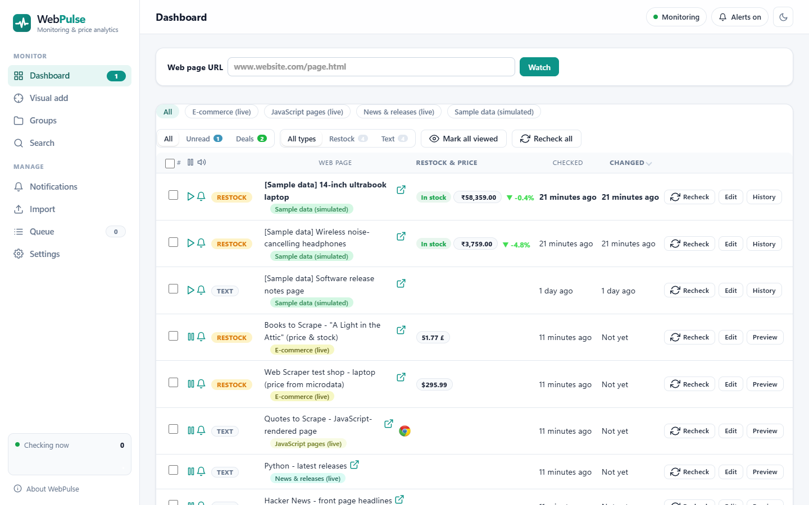

<p align="center"></p>

# WebPulse: Automated Web Monitoring and Price Analytics System

WebPulse is a final-year engineering project. It watches web pages for changes, tracks product prices and stock,
keeps a price history with analytics and charts, checks pages on a schedule with concurrent workers, sends
notifications, and exposes a REST API. Everything runs locally on Windows, with no Docker, no WSL and no paid
services.



## Based on changedetection.io

WebPulse is a modified and simplified version of the open-source
**[changedetection.io](https://github.com/dgtlmoon/changedetection.io)**, by Leigh Morresi and the changedetection.io
contributors, version 0.70.4, used under the Apache License 2.0.

* [LICENSE](LICENSE) is unchanged.
* [NOTICE](NOTICE) contains the upstream notice plus an addendum for this project.
* Every change is recorded in [CHANGES.md](CHANGES.md), and modified files carry a notice at the top.
* The original README is kept as [README.upstream.md](README.upstream.md).
* The WebPulse name, logo and interface design are original to this project. WebPulse is not affiliated with or
  endorsed by the changedetection.io project.

## Features

The Home page is organised around six things people monitor:

| Use case | What you get |
|---|---|
| Website monitoring | Each page is checked on a schedule; the change history shows added text in green and removed text in red. You can limit a watch to one part of a page |
| Product price tracking | The price is read from schema.org JSON-LD, microdata or a CSS selector, and every change is recorded |
| Stock availability | Alerts when a product sells out or comes back in stock |
| Job listing monitoring | Each opening on a careers page or job board (Lever, Greenhouse, schema.org JobPosting or any page with a CSS selector) is read with its title, location, type and apply link, filtered by keywords, and compared by its job link: new, removed and changed openings, a New badge, first detected / last seen, an openings chart and the job history |
| Historical price analytics | A price/stock chart, lowest / highest / average, "cheaper than N % of recorded prices", and XLSX export |
| Notifications | **Email** (Gmail, Outlook, … with an app password) and **Telegram** (your own bot), set up on one page with "Save and send test", plus a history of every message sent |

Behind the scenes, and reachable from Home → "Behind the scenes" and Settings → "More tools":
* scheduling, with per-watch intervals and time windows;
* concurrent workers with a live queue;
* plain-HTTP or real-browser page reading (Playwright driving the Microsoft Edge that ships with Windows);
* the REST API (`/api/v1/*`, API key);
* a plain-file datastore with backups and import;
* groups, search, password protection, and dark mode.

Technical options stay hidden behind "Show technical settings" and "Show technical options".

## Run it (Windows)

```powershell
# one-time setup (Python 3.11+)
py -3.12 -m venv C:\Users\<you>\venvs\cdio-simplified
C:\Users\<you>\venvs\cdio-simplified\Scripts\python.exe -m pip install -r requirements.txt

# optional demonstration data (run once, while WebPulse is stopped)
C:\Users\<you>\venvs\cdio-simplified\Scripts\python.exe demo\seed_demo.py         C:\Users\<you>\cdio-data\webpulse-demo
C:\Users\<you>\venvs\cdio-simplified\Scripts\python.exe demo\add_demo_site.py      C:\Users\<you>\cdio-data\webpulse-demo
C:\Users\<you>\venvs\cdio-simplified\Scripts\python.exe demo\setup_presentation.py C:\Users\<you>\cdio-data\webpulse-demo

# ONE command starts everything: headless Edge, the internal demo site and WebPulse
.\run.ps1                   # then open http://127.0.0.1:5000  (Ctrl+C stops everything it started)
.\run.ps1 -NoBrowser -NoDemoSite -Datastore D:\data\webpulse -Port 5001
```

Open **http://127.0.0.1:5000**. Everything binds to `127.0.0.1` only, and SSRF protection stays on. For a
step-by-step walkthrough and the presentation plan, see [docs/PRESENTATION_GUIDE.md](docs/PRESENTATION_GUIDE.md).
The complete feature-by-feature guide (operation, architecture, algorithms, source references and the final
checklist) is [docs/COMPLETE_WALKTHROUGH.md](docs/COMPLETE_WALKTHROUGH.md).

### Real websites and controlled demonstrations

| In the list | What it is |
|---|---|
| Normal titles, groups "Indian shops (live)", "Job listings", "… (live)" | **Real websites**, checked every 6–24 hours:<br>• Decathlon India, Sleepy Owl and boAt (INR prices; robots.txt allows product pages);<br>• HackerRank (Greenhouse), Meesho (Lever) and the python.org job board;<br>• the scraping sandboxes `books.toscrape.com`, `quotes.toscrape.com` and `webscraper.io`;<br>• Hacker News and python.org.<br>Every saved version comes from a real check |
| `[Demo] …` with a **Demo** chip, group "Demo site (simulated)" | **Controlled demonstration.** WebPulse's own small demo site on this computer. The **Controlled demo** page changes its price, stock, jobs or text on demand, and WebPulse then checks it with the same code it uses for real sites. It is reached only through the "WebPulse demo site" proxy, which never forwards |

No history is invented. The earlier "[Sample data]" watches with simulated history were removed in Phase 11.

## Tests

```powershell
.\e2e\run_unit.ps1               # upstream unit tests + template syntax + dependency/import checks
.\e2e\run_e2e.ps1 -Browser -UI   # 96 end-to-end checks
```

The 96 end-to-end checks are:
* 40 core and extended API checks;
* 5 persistence checks;
* 8 security checks: SSRF, password, CSRF;
* 8 checks of the JavaScript browser fetcher;
* 35 interface tests that click through the real UI in Microsoft Edge. These include the Email/Telegram set-up,
  the notification history, "Track jobs", the Controlled demo, and a check that the demo site never forwards
  requests.

The harness starts its own local fixture site and throw-away instances. More detail is in
[docs/SIMPLIFICATION_REPORT.md](docs/SIMPLIFICATION_REPORT.md). The presentation walkthrough is in
[docs/PRESENTATION_GUIDE.md](docs/PRESENTATION_GUIDE.md).
