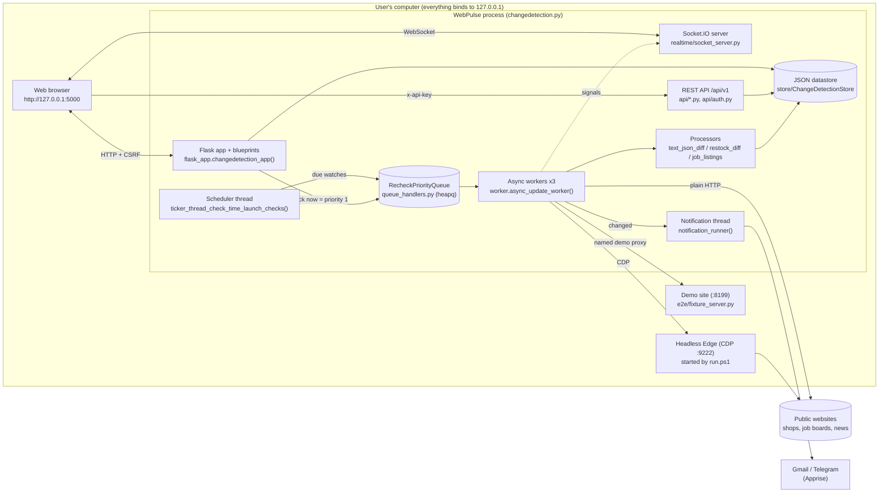
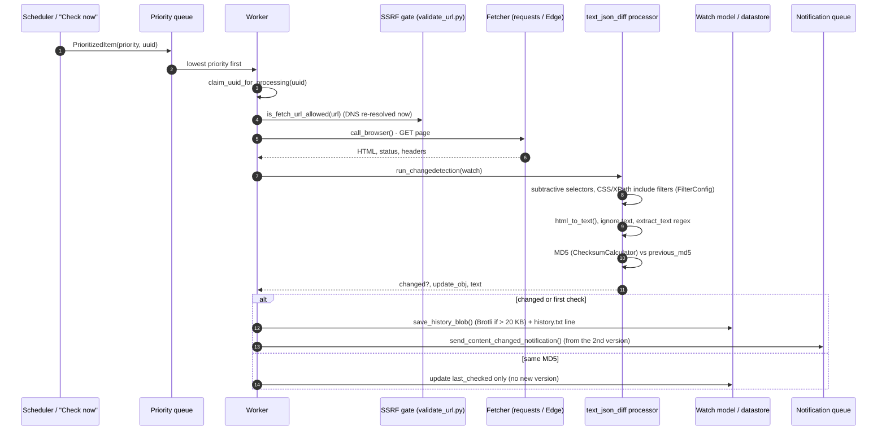
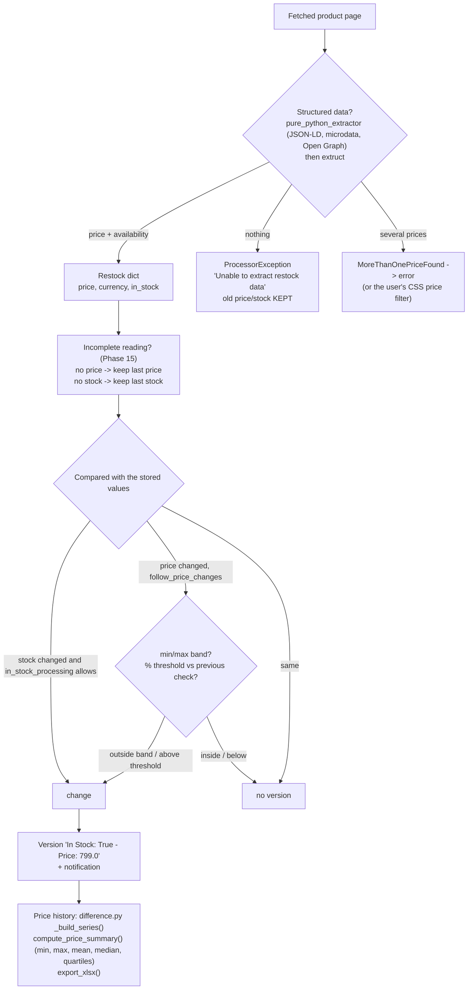
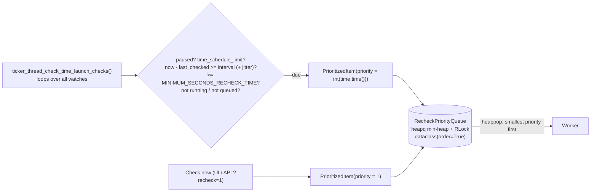
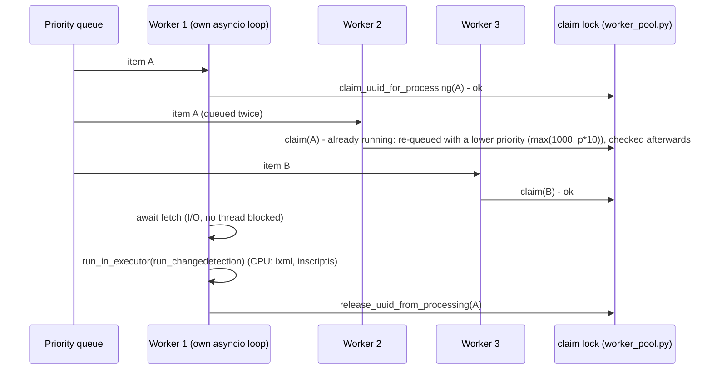
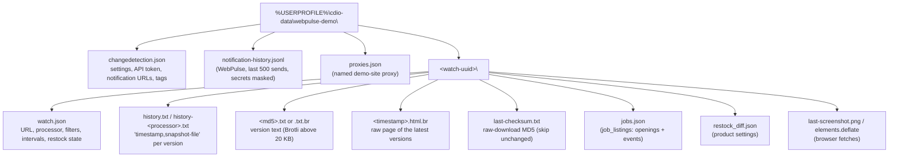
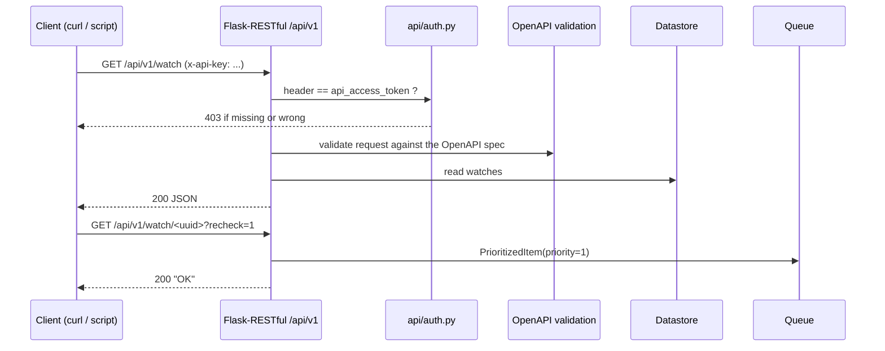
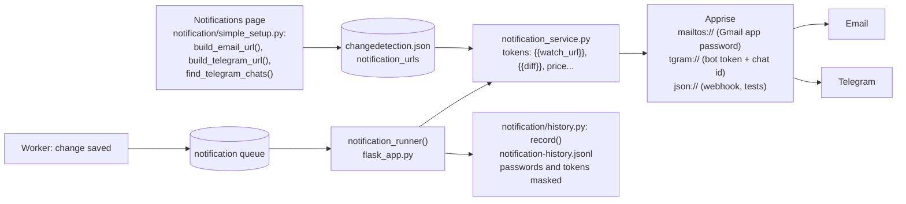

# WebPulse: system architecture

WebPulse is a **modular monolith**: one Python process holding a Flask web application, a scheduler thread, a pool
of asynchronous fetch workers, a notification thread and a JSON-file datastore. Two optional helper processes run
beside it: headless Microsoft Edge, for pages that need JavaScript, and the local demo site, for controlled
demonstrations.

The core engine is inherited from [changedetection.io](https://github.com/dgtlmoon/changedetection.io) (Apache-2.0).
`docs/ORIGINAL_CONTRIBUTIONS.md` says what WebPulse added or changed. Paths below are relative to `changedetectionio/`
unless they start with `e2e/`, `demo/` or `run.ps1`.

---

## 1. Overall system architecture



| Layer | Main files | Notes |
|---|---|---|
| Entry point | `changedetection.py` → `__init__.py: main()` | parses `-d <datastore> -p <port>`; `sigshutdown_handler()` saves and exits on SIGINT/SIGTERM |
| Web app | `flask_app.py: changedetection_app()`, `blueprint/*` | Jinja2 templates, Flask-WTF CSRF, optional password login |
| Real time | `realtime/socket_server.py: SignalHandler` | blinker signals → Socket.IO events to open pages |
| Scheduler | `flask_app.py: ticker_thread_check_time_launch_checks()` | one thread; finds due watches |
| Queue | `queue_handlers.py: RecheckPriorityQueue`, `queuedWatchMetaData.py: PrioritizedItem` | binary min-heap |
| Workers | `worker_pool.py: start_async_workers()`, `worker.py: async_update_worker()` | `FETCH_WORKERS` (3 by default in `run.ps1`) |
| Fetchers | `content_fetchers/requests.py`, `content_fetchers/playwright.py` | plain HTTP / Playwright over CDP to Edge |
| Processors | `processors/text_json_diff`, `processors/restock_diff`, `processors/job_listings` | one plug-in per kind of monitoring |
| Storage | `store/__init__.py: ChangeDetectionStore`, `store/file_saving_datastore.py: save_json_atomic()` | JSON + Brotli files |
| Notifications | `notification_service.py`, `notification/history.py`, `notification/simple_setup.py` | Apprise URLs |
| Security | `validate_url.py`, `api/auth.py`, Flask-WTF | SSRF gate, API key, CSRF |

---

## 2. Website monitoring workflow



* **Change detection:** an MD5 of the filtered text (`processors/text_json_diff/processor.py: ChecksumCalculator`).
  Identical text gives an identical hash, so no version is stored. This was verified live in Phase 14 for 4 sites.
* **Differences:** `diff/__init__.py: render_diff()` (difflib opcodes; word level with diff-match-patch). Added text
  is shown green and removed text red.
* **Filters:** CSS and XPath (`html_tools.include_filters()`, `xpath_filter()`), regex (`ContentTransformer.extract_by_regex()`),
  trigger and ignore text (`RuleEngine`).

---

## 3. Product price and stock monitoring



Source: `processors/restock_diff/processor.py: perform_site_check.run_changedetection()`, `get_itemprop_availability()`;
`processors/restock_diff/__init__.py: Restock.parse_currency()`, `get_price_change_percent()`.

---

## 4. Structured job monitoring (WebPulse)

```mermaid
flowchart TD
    A[Fetched careers page] --> E["extract.extract_jobs(html, url, selectors)"]
    E --> S1{"Which board?"}
    S1 -->|div.posting / .postings-wrapper| L[Lever]
    S1 -->|.job-post / div.opening| G["Greenhouse ('New' tag removed)"]
    S1 -->|li.opening-job| R[SmartRecruiters]
    S1 -->|user CSS/XPath section| C["Generic cards (_card_for, _parse_card)"]
    S1 -->|JSON-LD JobPosting| J[schema.org]
    S1 -->|none| AU[job-like links outside nav/footer]
    L & G & R & C & J & AU --> ID["Opening = title, company, location, type, team, url<br/>id = canonical job URL (tracking params removed)"]
    ID --> Z{"Any opening?"}
    Z -->|no, and confirmed_empty() finds an explicit signal| K
    Z -->|no signal| ERR["Error - every stored opening kept"]
    Z -->|yes| K["keyword_matcher(extract_text) on titles"]
    K --> T["tracker.apply_check(state, jobs, now, filter_hash, found)"]
    T --> B1{"first read / filters changed?"}
    B1 -->|yes| BL["baseline event - no alert<br/>(worker.suppress_change_notification)"]
    B1 -->|no| CMP["set comparison by id:<br/>new, removed, modified (field old -> new), re-opened"]
    CMP --> DROP{"drop to <= 20 % of >= 10?"}
    DROP -->|first time| SUS["SuspiciousDrop error - wait for confirmation"]
    DROP -->|no / confirmed| EV["event appended; jobs.json saved atomically"]
    EV --> SNAP["sorted one-line-per-opening text -> version + alert"]
```

* **Data structure:** `jobs.json` = `{jobs: {id: {title, company, location, employment_type, team, url, first_seen,
  added_at, last_seen, status, removed_at, modified_at, baseline, changes[]}}, events: [...], baseline_at,
  filter_hash, last_found, last_matched, declared_total, empty_reason, pending_drop}`.
* **Pages:** `blueprint/jobs/__init__.py` (`/jobs/`, `/jobs/<uuid>`) uses `tracker.summary()`, `filtered_jobs()`,
  `timeline()` and `chart_geometry()`.

---

## 5. Scheduler and priority queue



* **Why a heap:** insert and remove are O(log n), and a manual check (priority 1) always comes out before scheduled
  checks (priority = Unix time, about 1.8 × 10⁹).
* **Measured (Phase 14):** a 10-second interval gave gaps of 10/10/10/10 s. With all 3 workers busy, a manual check
  finished in 3.0 s, ahead of 3 queued scheduled checks.
* **Laptop sleep (Phase 15):** freezing the process for 35 s ran the overdue check 0.2–0.4 s after resume, then the
  normal 10 s rhythm returned, with no burst.
* **The queue lives in memory.** Manual checks still queued at shutdown are lost (measured 0/9). Scheduled checks
  are simply found due again after a restart (6/6).

---

## 6. Worker concurrency



* **Workers:** threads, each with its own asyncio event loop (`worker_pool.start_async_workers()`). Fetching is
  awaited; CPU-heavy parsing goes to an executor.
* **Race prevention:**
  * a UUID claim under a lock, so a watch is never processed twice at the same time (measured: 5 queued requests →
    2 sequential checks);
  * already-queued checks are skipped;
  * every write is atomic: a temporary file, then `os.replace`.
* **Measured:**
  * 6 × 3-second pages in 6.4 s (3 workers);
  * 1,000 local pages in 17.3 s with 3 workers (58 checks/s) and 10.3 s with 10 workers (97 checks/s).

---

## 7. Datastore and file layout



* **Writes:** `store/file_saving_datastore.py: save_json_atomic()` (temp file, `os.replace`, fsync) and
  `model/Watch.py: save_history_blob()`.
* **History indexes:** one per processor (`Watch.history_index_filename`). Switching a watch's processor shows a
  separate history; the old one stays on disk.
* **Measured:**
  * Brotli on real data: 33.6 MB → 3.8 MB (−88.6 %);
  * your live folder is 4.8 MB for 62 watches (median 110 KB per product, 21 KB per website, 41 KB per job board);
  * synthetic minimal pages take 3.4 KB per watch after the first version.

---

## 8. REST API communication



**Endpoints exercised in Phase 14:** `/systeminfo`, `/watch` (GET list, POST create), `/watch/<uuid>` (GET, PUT,
DELETE), `/watch/<uuid>/history`, `/watch/<uuid>/history/<ts>`, `/watch/<uuid>/difference/<a>/<b>`, `/tags`,
`/search?q=&partial=true`, `/import`. With no key or a wrong key the answer is 403.

---

## 9. Notification architecture



* **When an alert is sent:** a notification is queued only from the second version onwards, and never for a
  job-board baseline or for muted watches.
* **Delivery:** real delivery to Gmail or Telegram needs your own credentials. It has **not** been verified in this
  project (`docs/KNOWN_LIMITATIONS.md`).

---

## 10. Bottlenecks and scaling (summary; details in FINAL_PROJECT_READINESS.md §7)

| Resource | Measured | Practical limit on one laptop |
|---|---|---|
| Check throughput (local pages, plain HTTP) | 58/s with 3 workers, 97/s with 10 (1,000 watches) | real sites: limited by network latency (~1–2 s per page) to roughly 1.5–3 checks/s with 3 workers |
| Browser checks | 6–11 s each | ~0.3–0.5/s with 3 workers; Edge memory grows with concurrent pages |
| Memory | 96 MB empty, 106 MB with 1,000 watches | not the bottleneck up to thousands of watches |
| Startup | 2.9 s (100 watches), 15 s (1,000) | ~linear; about 2.5 min estimated for 10,000 (not measured) |
| Page latency | Home 0.04 s, list 0.05 s, API list 0.11 s at 1,000 | the list page paginates |
| Storage | 3.4 KB to 110+ KB per watch, more with history | disk is not the limit; the many small files are |
